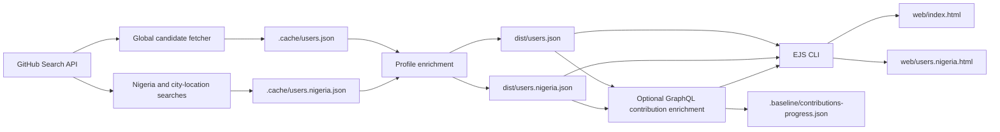

# Architecture

## Runtime and data flow

1. `getUsers` queries `followers:>=GLOBAL_MIN_FOLLOWERS` (default 1,000). `getUsersNigeria` searches `followers:>=MIN_FOLLOWERS` (default 100) across Nigeria and named Nigerian cities. Each search uses GitHub's `total_count`, fetches up to ten 100-result pages, and respects a 1,000-profile dataset cap.
2. Candidate identities are deduplicated by GitHub user ID and normalized login across all location queries. Each fetcher writes the raw candidate list and a search checkpoint to its own `.cache` JSON files, including the next location/page. An interrupted search resumes from that checkpoint. A successful profile enrichment saves the full profile to progress before removing that candidate from the cache; a failed API call leaves it available for a later run. A status file distinguishes a completed empty cache from a new search that returned no candidates.
3. `getUserInfo` loads candidates and profiles completed in the current refresh, fetches current profile details for global users, then reuses those refreshed global profiles for matching Nigerian users. It deduplicates by login, sorts by follower count, and assigns sequential ranks.
4. Enriched data is written to `dist/users.json` and `dist/users.nigeria.json`. The optional GraphQL contribution stage reuses per-profile snapshots younger than seven days, checkpoints validated public stats in `.baseline/contributions-progress.json`, and can stop after 15 minutes or when the measured GraphQL rate-limit reserve is reached. It is non-blocking for valid follower rankings. `.ejscrc.json` binds the generated ranking wrappers to the EJS templates; `npm start` writes the static pages to `web/`.

## Boundaries

- External integration: GitHub REST API (`/search/users`, `/users/{login}`) and optional GitHub GraphQL `User.contributionsCollection`. Profile refresh uses `ACCESS_TOKEN`; contribution collection also requires it, and never writes it to generated data.
- Persistence: local JSON files only. `.cache/` holds resumable raw candidates; `dist/` holds enriched ranking data; `web/` holds generated HTML.
- UI: EJS templates and shared partials, with no runtime server or browser-side data fetch.
- Data interpretation: the `location` field is user-supplied. City-name matches are search signals only and do not prove nationality or current residence.
- Automation: push/pull-request CI tests the project. Pushes to `main`, manual deployments, and the daily 02:00 UTC schedule use one serialized Pages workflow. The workflow reads `ACCESS_TOKEN`, rediscovers and validates both rankings, then uploads only `web/` as the Pages artifact; generated data is not committed to Git.

## Differences from the reference

## Find My Rank and contribution details

`template/pagination.js` owns client-side filtering, 50-row pagination, exact username normalization, cross-board lookup, page navigation, and shareable `?user=` links. EJS embeds public ranking profile fields and verified per-profile contribution records in static HTML. Safe DOM text APIs and host-checked HTTPS profile/avatar URLs are used for the detail panel.

Contribution fields are per-user, rolling 365-day public snapshots with an individual collection timestamp. The contribution API explicitly reports `hasAnyRestrictedContributions`; when true or absent, aggregate activity is withheld. The collector records public contribution totals, PRs opened/merged, issues, pull-request review contributions, external public repositories with visible activity, and the conservative licensed-external-code-repository signal. GitHub caps repository groups and connections at 100 records per request; capped or missing data becomes unavailable rather than zero. Full contribution enrichment is bounded and never prevents a valid follower-only publish.

The target replaces the China-specific page/data with Nigeria and focuses navigation on global/Nigeria users. The source's repository, organization, and trending scrapers and pages are not part of this focused adaptation. Historical source provenance is recorded in the ProjectDNA files; the original MIT copyright and license text remains in `LICENSE`.
