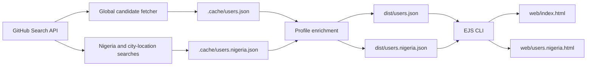

# Architecture

## Runtime and data flow

1. `getUsers` queries `followers:>=GLOBAL_MIN_FOLLOWERS` (default 1,000). `getUsersNigeria` searches `followers:>=MIN_FOLLOWERS` (default 100) across Nigeria and named Nigerian cities. Each search uses GitHub's `total_count`, fetches up to ten 100-result pages, and respects a 1,000-profile dataset cap.
2. Candidate identities are deduplicated by GitHub user ID and normalized login across all location queries. Each fetcher writes the raw candidate list and a search checkpoint to its own `.cache` JSON files, including the next location/page. An interrupted search resumes from that checkpoint. A successful profile enrichment saves the full profile to progress before removing that candidate from the cache; a failed API call leaves it available for a later run. A status file distinguishes a completed empty cache from a new search that returned no candidates.
3. `getUserInfo` loads candidates and profiles completed in the current refresh, fetches current profile details for global users, then reuses those refreshed global profiles for matching Nigerian users. It deduplicates by login, sorts by follower count, and assigns sequential ranks.
4. Enriched data is written to `dist/users.json` and `dist/users.nigeria.json`. `.ejscrc.json` binds these files to the `USERS` and `USERS_NIGERIA` template variables; `npm start` writes the static pages to `web/`.

## Boundaries

- External integration: GitHub REST API (`/search/users`, `/users/{login}`). `ACCESS_TOKEN` is optional locally; authenticated profile requests get higher core rate-limit headroom.
- Persistence: local JSON files only. `.cache/` holds resumable raw candidates; `dist/` holds enriched ranking data; `web/` holds generated HTML.
- UI: EJS templates and shared partials, with no runtime server or browser-side data fetch.
- Data interpretation: the `location` field is user-supplied. City-name matches are search signals only and do not prove nationality or current residence.
- Automation: push/pull-request CI tests the project. Pushes to `main`, manual deployments, and the existing seven-day schedule use one serialized Pages workflow. The workflow reads `ACCESS_TOKEN`, regenerates and validates ranking data, and uploads only `web/` as the Pages artifact; it does not publish packages or write generated files to Git.

## Differences from the reference

The target replaces the China-specific page/data with Nigeria and focuses navigation on global/Nigeria users. The source's repository, organization, and trending scrapers and pages are not part of this focused adaptation. Historical source provenance is recorded in the ProjectDNA files; the original MIT copyright and license text remains in `LICENSE`.
